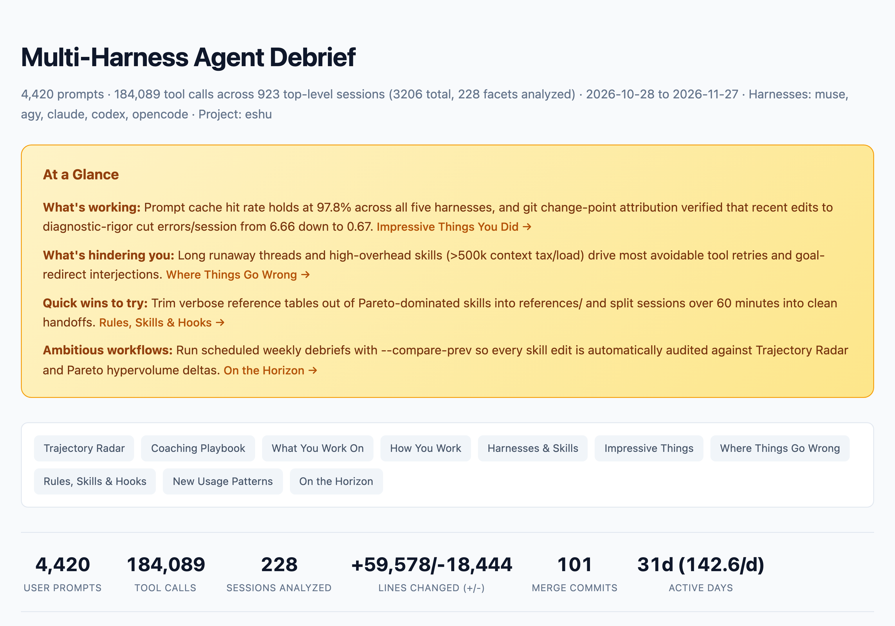
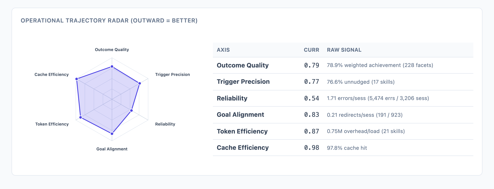
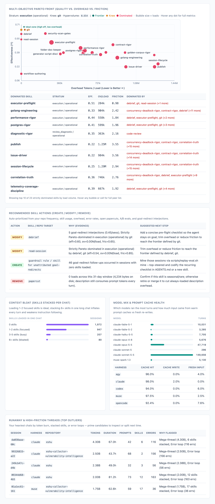

# debrief

Multi-harness operational debrief for AI coding agents — **Claude Code**, **Codex**, **OpenCode**, **Antigravity (`agy`)**, **Muse**, and **Cursor**.

Mines local session transcripts, caches semantic facets, merges optional content-free hook telemetry and git history, and renders an offline interactive HTML report featuring:

- **Flexible scoping** — current session (`--current`), explicit sessions (`--session`, `--sessions-file`), single provider (`--harness`), or full history (`--all-time`) + `debrief sessions` discovery.
- **Report-to-report diff & accountability** — persists compact content-free snapshots and verifies whether prior recommendations were implemented and actually worked (`implemented_verified`, `implemented_ineffective`, `implemented_pending_data`, `not_done`, `resolved_externally`).
- **6-axis Trajectory Radar** — inline-SVG radar across Outcome Quality, Trigger Precision, Reliability, Goal Alignment, Token Efficiency, and Cache Efficiency (overlaid dashed previous vs. filled current in diff mode).
- **Multi-Objective Pareto Fronts** — noise-aware per-`(skill, harness)` version fronts with knee point, `HEAD` regression alerts, and exact 2D hypervolume (`HV` / `ΔHV`), plus stratified skill portfolio fronts and inline-SVG scatter plots.
- **Git change-point / post-edit attribution** — detects per-skill `SKILL.md` and `hooks/` last-edit commits so pre-fix history does not trigger stale `MODIFY` recommendations after you have already improved a skill or hook.
- **Zero external dependencies & local-first privacy** — pure Python 3 + Node >= 18 + inline CSS/SVG HTML reports. Raw prompts stay on disk and are never uploaded.

---

## Installation

### 1. Claude Code Plugin Marketplace
In Claude Code:
```text
/plugin marketplace add linuxdynasty/debrief
/plugin install debrief@debrief
```
This installs the `/debrief` skill and optional lightweight content-free `PostToolUse` (`Skill`) and `StopFailure` telemetry hooks automatically.

### 2. Universal Installer via `npx` (all harnesses)
Works with **Claude Code**, **Codex**, **OpenCode**, **Antigravity (`agy`)**, **Muse**, and **Cursor**:

```bash
# Auto-detect installed harnesses and install /debrief skill + lightweight telemetry hooks
npx @linuxdynasty/debrief install --with-hooks

# Or directly from GitHub before npm publish:
npx github:linuxdynasty/debrief install --with-hooks

# Target specific harnesses or all 6:
npx @linuxdynasty/debrief install --harness claude,codex,opencode --with-hooks
npx @linuxdynasty/debrief install --all --with-hooks
```

When invoked via `npx`, the installer stages a stable copy of the runtime into `~/.local/share/debrief/runtime/` and links `~/.local/bin/debrief` so `/debrief` and hooks keep working after npm cleans its `_npx` cache.

### 3. `skills` CLI (skill-only install)
```bash
npx skills add linuxdynasty/debrief
```

### 4. Universal `curl` One-Liner / Global CLI / From Source
```bash
# Universal curl-pipe-bash installer (auto-detects all installed harnesses):
curl -fsSL https://raw.githubusercontent.com/linuxdynasty/debrief/main/install.sh | bash
curl -fsSL https://raw.githubusercontent.com/linuxdynasty/debrief/main/install.sh | bash -s -- --with-hooks

# Global npm CLI:
npm install -g @linuxdynasty/debrief

# Or from a local clone:
git clone https://github.com/linuxdynasty/debrief.git
cd debrief && ./install.sh --all --with-hooks
```

### Uninstall & Diagnostics
```bash
debrief doctor               # Check python3, detected harnesses, skills, hooks, cache
debrief uninstall --all      # Remove debrief skills & hooks (preserves all other user hooks)
```

---

## Per-Harness Support Matrix

| Harness | Transcript Mining | Skill Install Path | Optional Telemetry Hooks (`--with-hooks`) |
|---|---|---|---|
| **Claude Code** | `~/.claude/projects/**/*.jsonl` + native facets | `~/.claude/skills/debrief` (or native plugin) | `PostToolUse` (`Skill`) + `StopFailure` merged into `~/.claude/settings.json` |
| **Codex** | `~/.codex/sessions/**/*.jsonl` + `archived_sessions/*.jsonl.zst` | `~/.codex/skills/debrief` | `PostToolUse` merged into `~/.codex/hooks.json` |
| **OpenCode** | SQLite v2 + legacy v1 stores | `~/.config/opencode/skill/debrief` | Zero-dep V2 plugin `~/.config/opencode/plugins/debrief-telemetry.js` |
| **Antigravity (`agy`)** | `~/.gemini/antigravity*/brain/**/transcript.jsonl` | `~/.gemini/config/skills/debrief` | Dedicated `"debrief"` block in `~/.gemini/config/hooks.json` |
| **Muse** | `~/.local/share/muse/sessions/**/*.jsonl` | `~/.agents/skills/debrief` | Managed hooks file (never clobbers existing `managed_hooks_path`) |
| **Cursor** | Skill install | `~/.cursor/skills/debrief` | Skill-only |

Opt out of hook telemetry at any time with `DEBRIEF_TELEMETRY_OFF=1`.

---

## Usage

### Inside any harness
Invoke `/debrief`:
- `/debrief` — default 30-day debrief across all 5 harnesses
- `/debrief for the current session` — single-session Deep-Dive (`--current`)
- `/debrief for codex and opencode all time` — `--harness codex,opencode --all-time`
- `/debrief compare against previous report` — `--compare-prev` with overlaid Trajectory Radar + accountability

### Directly from the CLI
```bash
# Discover recent sessions and IDs
debrief sessions --days 14 --limit 20

# Stage 1: extract/cache metadata and emit Stage 2 facet batches
debrief prepare --days 30 --harness all
debrief prepare --current
debrief prepare --session abc12345 --session def67890
debrief prepare --harness codex,opencode --all-time

# Stage 2: store validated semantic facets
debrief cache-write facets-batch-01.json

# Stage 3: aggregate across harnesses, hooks, git change-points, Pareto fronts & diff
debrief aggregate --days 30 --harness all --repo "$PWD" \
  --skills-dir ~/.claude/skills --compare-prev --out /tmp/agg.json

# Standalone diff between any two snapshots or snapshot vs aggregate
debrief diff --prev snap-a.json --curr /tmp/agg.json

# Stage 4: render offline interactive HTML report + human-legible CLI summary
debrief render --aggregate /tmp/agg.json --synthesis /tmp/synthesis.json
# (pass --json for compact path JSON, or reprint the summary anytime:)
debrief summary --aggregate /tmp/agg.json --synthesis /tmp/synthesis.json
```

Reports and snapshots are written under `$DEBRIEF_DATA_DIR/debrief-reports/` (default `~/.local/share/debrief/debrief-reports/`).

---

## Example Report & CLI Output

See a real sanitized multi-harness report generated from open-source [Eshu](https://github.com/eshu-hq/eshu) sessions across all 5 harnesses: **[`examples/eshu-sample-report.html`](examples/eshu-sample-report.html)** (download and open locally in any browser — 100% offline, zero external requests).

### Terminal Summary (`debrief render` / `debrief summary`)
```text
========================================================================
DEBRIEF SUMMARY  (since 2026-10-28)
========================================================================
  Report   : ~/.local/share/debrief/debrief-reports/report-2026-11-27-141200.html
  Latest   : ~/.local/share/debrief/debrief-reports/report-latest.html
  Snapshot : ~/.local/share/debrief/debrief-reports/snapshots/snap-20261127-141200.json

COVERAGE
  Sessions : 3,206 total (923 top-level) | 228 facets | 31 active day(s)
  Harnesses: muse=1795, claude=1240, agy=86, opencode=83, codex=2
  Activity : 4,420 prompts | 184.1k tool calls | 5,474 errors | cache hit 97.8%

TRAJECTORY RADAR (0-100%, higher = better)
  Outcome Quality   :  79%          | Trigger Precision :  77%
  Reliability       :  54%          | Goal Alignment    :  83%
  Token Efficiency  :  87%          | Cache Efficiency  :  98%

POST-EDIT IMPACT (Git Change-Points)
  Skills   : 22 edited in window (1 improved, 21 awaiting data, 0 unchanged, 0 regressed)
    - diagnostic-rigor (0c21179) [improved]: 6.66 -> 0.67 errors/session
  Hooks    : 052d923 — awaiting_data

PARETO FRONT & DIFF ACCOUNTABILITY
  Pareto    : 2 strata | 23 dominated | HEAD regressions: 0 | HV=0.4933
========================================================================
```

### Interactive Offline HTML Report Previews

Browse the **[full 10-section screenshot walkthrough in `examples/README.md`](examples/README.md)** or download [`examples/eshu-sample-report.html`](examples/eshu-sample-report.html) to explore every chart interactively offline.

**Overview, At a Glance & KPI Strip**


**6-Axis Operational Trajectory Radar**


**Multi-Objective Pareto Front, Skill Actions & Cache Health**


---

## Environment Variables

| Variable | Default | Purpose |
|---|---|---|
| `DEBRIEF_DATA_DIR` | `$XDG_DATA_HOME/debrief` | Root directory for cache, reports, snapshots, and `skills-usage.jsonl` |
| `DEBRIEF_ALIASES_FILE` | *(none)* | Optional TSV (`alias<TAB>canonical`) for normalizing renamed skills |
| `DEBRIEF_SKILLS_DIRS` | *(none)* | Colon-separated skill directories for overhead & change-point tracking |
| `DEBRIEF_TELEMETRY_OFF` | `0` | Set to `1` to disable hook telemetry emission |

---

## Development & Testing

```bash
npm test            # Runs all 11 test suites (Python, shell, installer, OpenCode V2 plugin)
npm pack --dry-run  # Inspect published package tarball contents
```

## Releasing

Tagging `vX.Y.Z` triggers [`.github/workflows/release.yml`](.github/workflows/release.yml), which verifies version parity across the git tag, `package.json`, and `.claude-plugin/plugin.json`, runs ShellCheck + `npm test`, packs and smoke-tests the tarball, publishes to npm with provenance (when `secrets.NPM_TOKEN` or repository variable `NPM_PUBLISH=true` for npm Trusted Publishing is set), and creates the GitHub Release with the `.tgz` asset and `SHA256SUMS`:

```bash
# Tag matching package.json & .claude-plugin/plugin.json (e.g. vX.Y.Z):
VER="$(node -p 'require("./package.json").version')"
git tag -a "v${VER}" -m "Release v${VER}"
git push origin "v${VER}"
```

License: [MIT](LICENSE)
