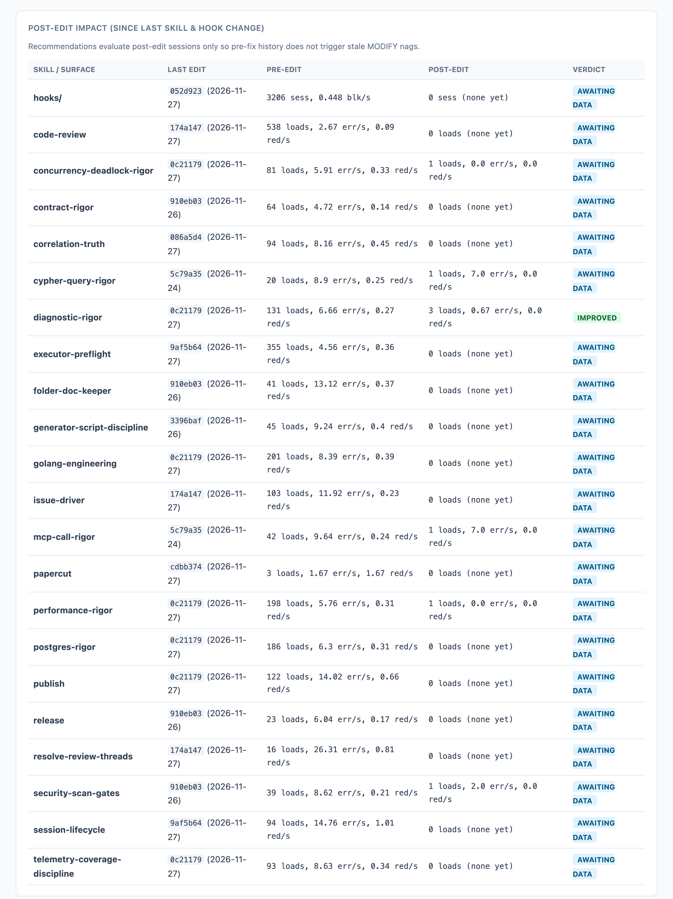
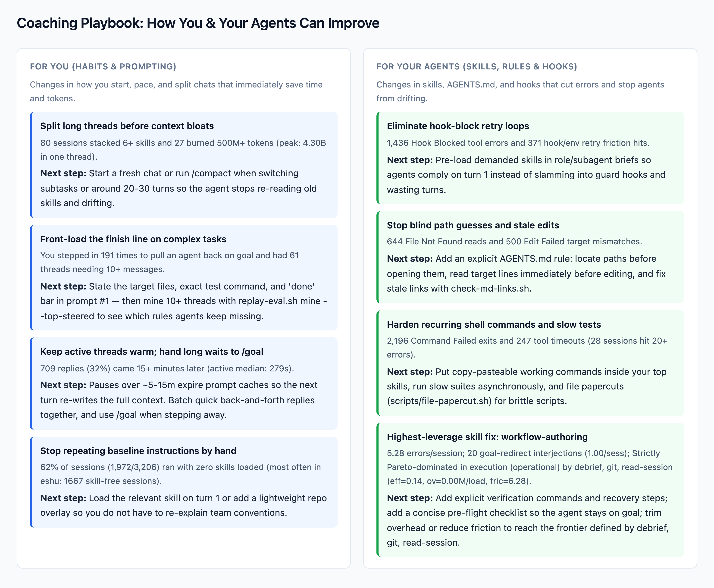
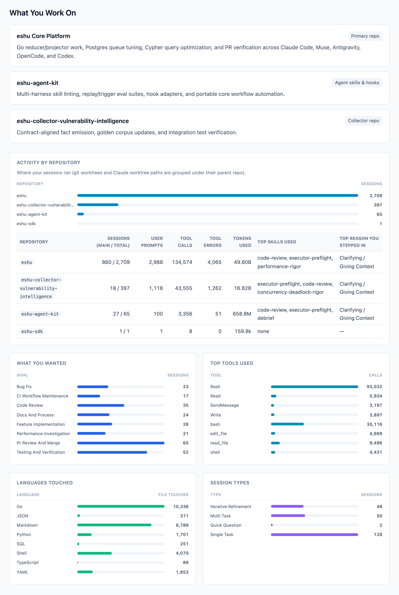
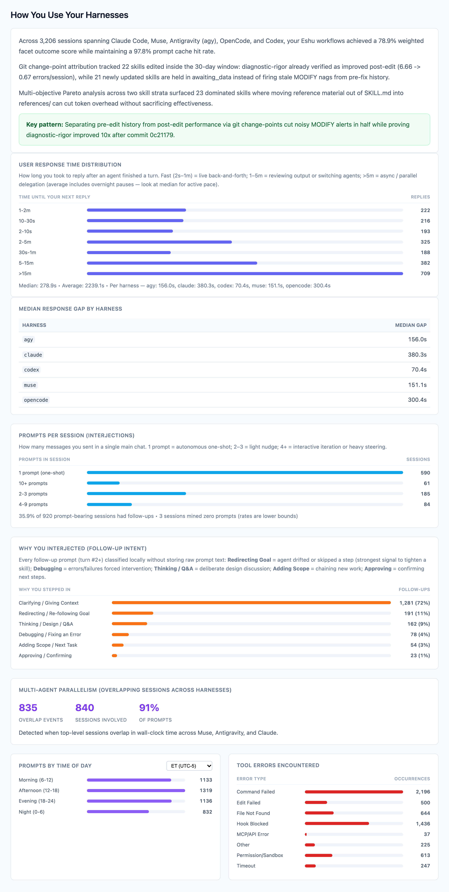
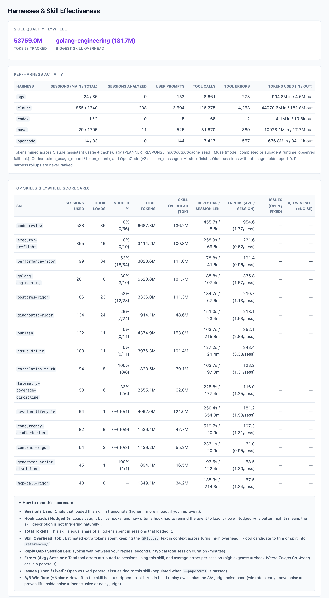
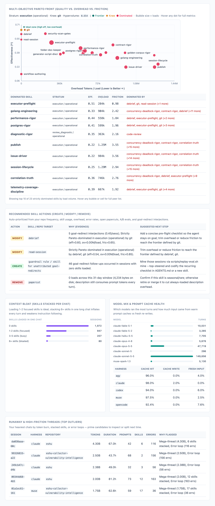
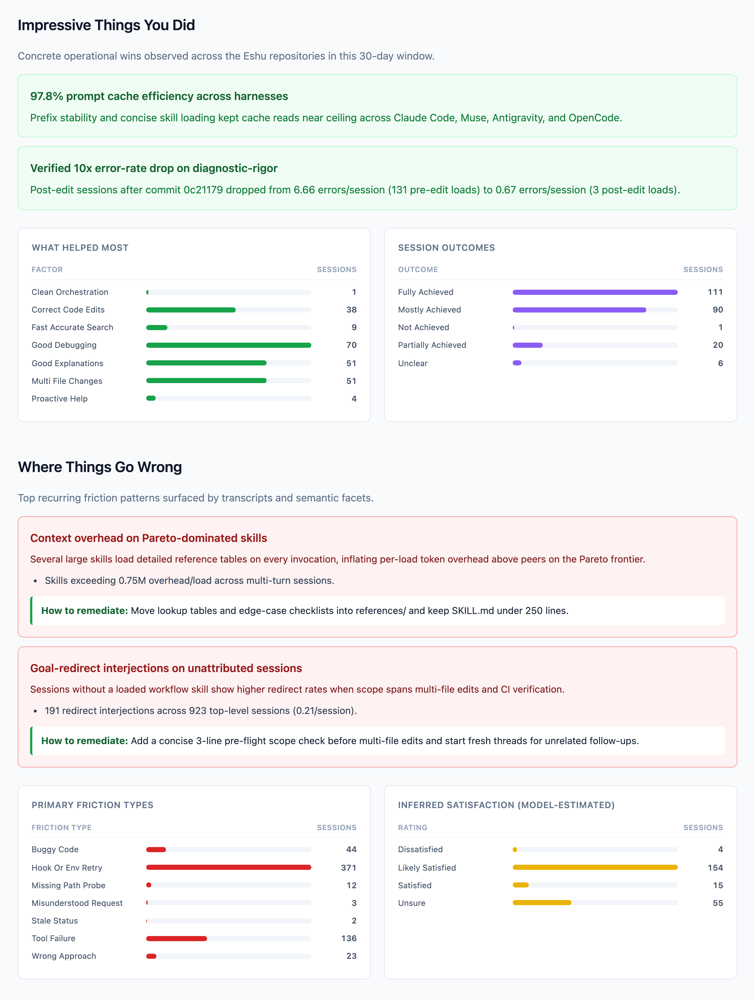
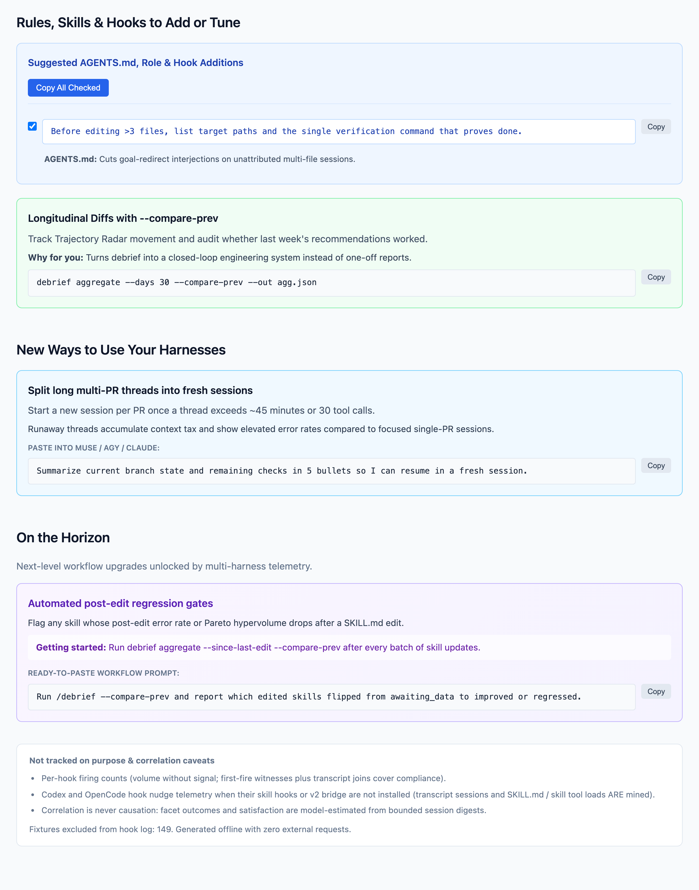

# Example Multi-Harness Debrief Report

This folder contains a real, sanitized 30-day multi-harness debrief generated from open-source [Eshu](https://github.com/eshu-hq/eshu) sessions across **Claude Code**, **Muse**, **Antigravity (`agy`)**, **OpenCode**, and **Codex**:

- **Interactive offline HTML report:** [`eshu-sample-report.html`](eshu-sample-report.html) — download and open locally in any browser (zero external requests, inline CSS and SVG).
- **Section-by-section screenshots:** [`screenshots/`](screenshots/) — captured directly from `eshu-sample-report.html` below.

---

## 1. Overview, At a Glance & KPI Strip

Headline session coverage across all 5 harnesses, synthesized takeaways, quick navigation bar, and top-level KPI metrics.

## 2. Post-Edit Impact (Git Change-Points)

Attributes every skill (`SKILL.md`) and `hooks/` directory to its most recent git edit so pre-fix history does not generate stale `MODIFY` recommendations.

## 3. Operational Trajectory Radar

Six normalized 0–100% axes (Outcome Quality, Trigger Precision, Reliability, Goal Alignment, Token Efficiency, Cache Efficiency). In `--compare-prev` mode, the prior snapshot overlays as a dashed polygon for instant regression/improvement detection.

## 4. Two-Sided Coaching Playbook

Concrete actions split into **For You (Habits & Prompting)** and **For Your Agents (Skills, Rules & Hooks)**, backed directly by session counts and error totals.

## 5. What You Work On

Per-repository rollups (merging git worktrees back to their parent repo), goals, top tools, languages touched, and session types.

## 6. How You Use Your Harnesses

Response-time cadence, interjection depth, local follow-up intent classification (without storing raw prompts), cross-harness parallelism, active hours, and tool-error breakdown.

## 7. Harnesses & Skill Effectiveness (Flywheel Scorecard)

Per-harness token/tool rollups and the full per-skill flywheel scorecard (sessions used, hook-nudged trigger rate, token overhead per load, reply gap, error rate, and replay eval lift).

## 8. Multi-Objective Pareto Front, Skill Actions, Cache Health & Runaway Threads

Full-width Pareto scatter (effectiveness vs. token overhead/load) with frontier/knee/dominated classification, prioritized `CREATE`/`MODIFY`/`REMOVE` actions, context-bloat & prompt-cache health, and top runaway threads.

## 9. Impressive Things You Did & Where Things Go Wrong

Verified operational wins, helpfulness factors, session outcomes, recurring friction patterns with concrete remediation steps, and model-estimated satisfaction.

## 10. Rules, Skills & Hooks to Add or Tune, New Patterns & On the Horizon

Copy-pasteable `AGENTS.md` / rule additions, longitudinal `--compare-prev` workflow prompts, and explicit correlation caveats.

