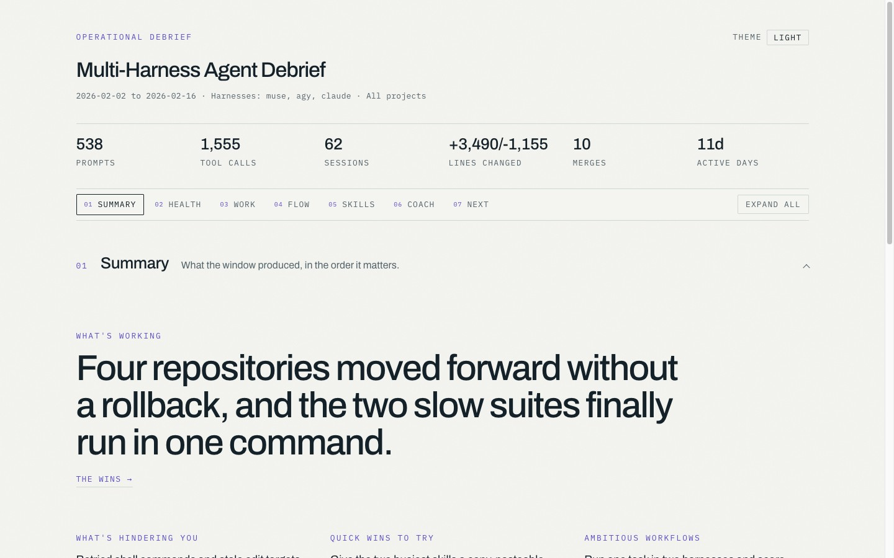
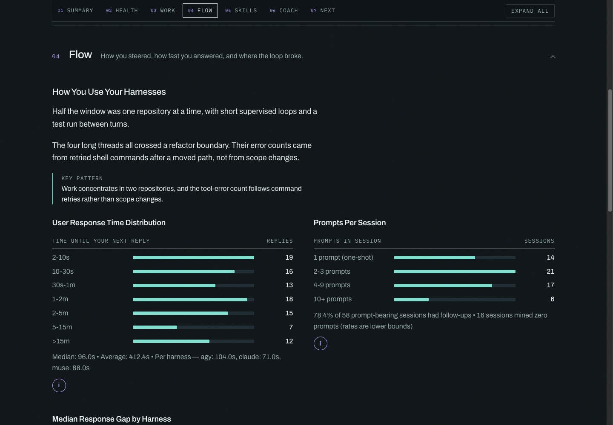
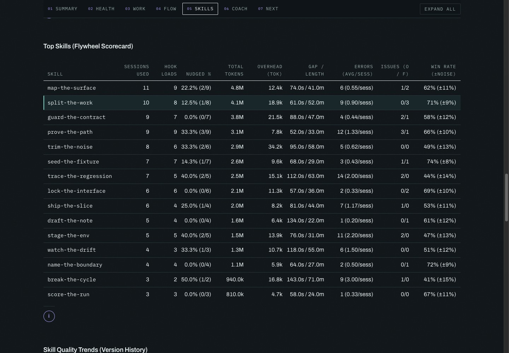
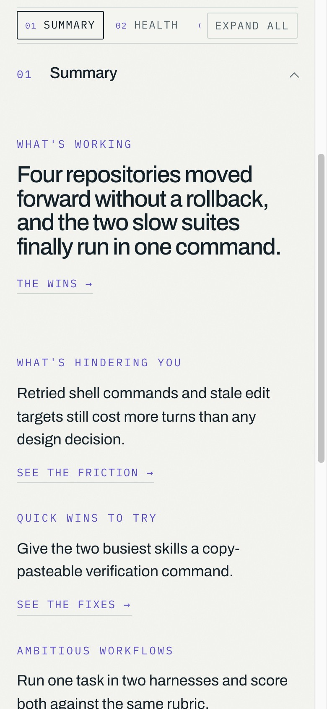

# Example Multi-Harness Debrief Report

[`demo-sample-report.html`](demo-sample-report.html) is a complete report rendered
from synthetic data. Open it locally in any browser. It makes zero external
requests: the CSS, the JavaScript, the fonts, and every chart are inline.

The data is fictional. It describes a four-repository project family called
*Atlas Relay*, three harnesses, eighteen skills, and sixteen days of activity.
No session, path, prompt, or skill name comes from a real person's transcripts.
The fixture exists so that design work and screenshots can be published without
leaking anyone's working history.

## Screenshot tour



The report opens with the briefing and headline metrics. Six more groups remain
collapsed until needed.



The dark theme uses the same spacing and hierarchy. Cyan marks evidence, purple
marks direction, and red marks adverse states.



Dense tables retain their data while row hover, restrained rules, and readable
column labels make them easier to scan.



The mobile report preserves the reading order and uses a 43px sticky navigation
bar. Method notes become viewport-safe info tooltips.

## Regenerate the example

```bash
cd debrief
python3 scripts/lib/debrief_demo_fixture.py \
  --out-dir scripts/fixtures \
  --html examples/demo-sample-report.html
```

The generator is a pure function of a fixed table, so two runs produce
byte-identical output. `scripts/tests/test-debrief-fixture.sh` fails when the
committed HTML, the committed JSON, or the renderer drifts from that table.

## What the report contains

Seven disclosure groups, in reading order. Only the summary is open on load.

| Group | Contents |
|---|---|
| 01 Summary | The three-line briefing: what worked, what hindered, what to try |
| 02 Health | Six-axis radar, diff against the previous report, post-edit impact, session health, cache |
| 03 Work | Project areas, repository activity, goals, tools, languages, session types |
| 04 Flow | Narrative, response gaps, prompt distribution, interjection reasons, hours, tool errors |
| 05 Skills | Per-harness activity, the skill scorecard, version trends, trigger evals, Pareto front, recommendations |
| 06 Coach | Wins, friction with remediation, coaching playbook, rules and skills to add |
| 07 Next | Usage patterns, horizon workflows, and what the report does not track |

## Changing the data

Edit the tables at the top of `scripts/lib/debrief_demo_fixture.py`:

- `SKILLS` drives the scorecard, cost attribution, and Pareto front.
- `_SPEC` holds the first twelve sessions; `_demo_metas()` generates the rest.
- `build_demo_synthesis()` holds the model-written narrative fields, which a real
  run would get from the synthesis step.

Derived documents are computed by the same functions the pipeline uses
(`session_health_stats`, `build_coaching_playbook`, `compute_radar_profile`,
`compute_pareto_analysis`), so the fixture cannot drift from the aggregator's
shapes.
